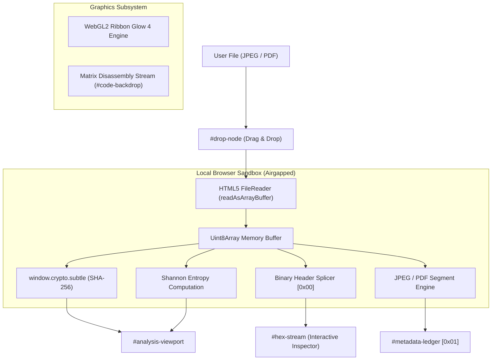

<div align="center">

# AEROHEX.
### Client-Side Memory Segment Analysis & Binary Forensic Engine

[](https://github.com/pranav-aitha/AeroHex)
[](https://github.com/pranav-aitha/AeroHex)
[](https://pranav-aitha.github.io/AeroHex/)
[](LICENSE)

<p align="center">
  <strong>A serverless, air-gapped web application for client-side binary segment splicing, hex inspection, and forensic telemetry extraction.</strong>
  <br />
  <em>Zero Server Uploads • Zero Analytics • Zero External Network Calls</em>
</p>

[**Live Demo Sandbox**](https://pranav-aitha.github.io/AeroHex/) • [**Explore Features**](#-key-features) • [**Architecture**](#-zero-trust-architecture) • [**Forensic Pipeline**](#-forensic-analysis-pipeline)

---

</div>

## 🌐 Overview

**AeroHex** is a client-side forensic analysis tool engineered for reverse engineers, security analysts, and digital forensics practitioners. It inspects raw byte sequences directly inside the browser using HTML5 `FileReader` and typed `ArrayBuffer` APIs.

By executing entirely client-side, AeroHex guarantees that sensitive documents, evidence files, and proprietary binaries never leave your workstation.

---

## ⚡ Key Features

- **Zero-Trust Memory Isolation**: Files are read into transient JavaScript `ArrayBuffer` memory within the browser sandbox. No backend servers, external APIs, or data telemetry exist.
- **Ribbon Glow 4 Visual Engine**: Real-time WebGL2 fragment shader (`FIELD_SRC` and `FINISH_SRC`) rendering procedural fluid splines with mouse inertia, twist dynamics, and color travel.
- **Decompiled Syntax Matrix Backdrop (`#code-backdrop`)**: Fixed multi-column overlay mimicking scrolling x86_64 disassembly, memory registers, and opcode byte sequences.
- **Interactive Binary Header Splicer (`[0x00]`)**: Dual-pane hex dump with offset indicators, hex byte groupings, and ASCII representation.
- **Live Byte Inspector**: Hover over any byte in the dump to inspect its absolute memory offset, hex value, decimal integer, 8-bit binary representation, ASCII character, and known segment marker annotations.
- **Extracted Telemetry Registers (`[0x01]`)**:
  - **Shannon Entropy Gauge**: Real-time entropy calculation ($0.00$ to $8.00$ bits/byte) to detect encryption, compression, and obfuscated payloads.
  - **Cryptographic Digest**: High-speed SHA-256 generation via `window.crypto.subtle`.
  - **MIME & Magic Verification**: Validates file magic headers (`0xFFD8` for JPEG, `0x25504446` for PDF).
- **Format-Specific Forensic Parsers**:
  - **JPEG / JFIF / EXIF**: Parses `SOI`, `APP0` (JFIF resolution), `APP1` (EXIF telemetry), `DQT`, `SOF0/SOF2` (dimensions, precision, channels), `DHT`, `SOS`, and `EOI`.
  - **PDF Security Scanner**: Verifies PDF specification version, linearization flags, cross-reference tables, object counts, `/Encrypt` dictionary flags, `/JavaScript` injection vectors, and `/Launch` executable hooks.
- **Synthesized Cyber Audio**: Procedural sound effects generated on-the-fly with the Web Audio API for tactile user feedback.
- **Export & Portability**: 1-click JSON telemetry export and hex buffer copying.

---

## 🔬 Zero-Trust Architecture



---

## 🛠️ Forensic Analysis Pipeline

### 1. JPEG Segment Splicing
AeroHex traverses marker delimiters (`0xFF` prefix) to extract structural segments without decompressing the raw raster:
- **`0xFFD8` (SOI)**: Start of Image validation.
- **`0xFFE0` (APP0)**: JFIF version, pixel aspect ratio, and X/Y density.
- **`0xFFE1` (APP1)**: TIFF header, endianness (`II` / `MM`), EXIF metadata.
- **`0xFFC0` / `0xFFC2` (SOF)**: Precision, height, width, and color components.
- **`0xFFDB` / `0xFFC4`**: Quantization & Huffman table indices.

### 2. PDF Document Heuristics
- **Header Magic**: `%PDF-1.x` signature extraction.
- **Cross-Reference & Linearization**: Fast Web View detection.
- **Threat Vector Detection**: Scans object streams for malicious executable triggers:
  - `/JS` and `/JavaScript` payload injection.
  - `/Launch` actions (external process invocation).
  - `/Encrypt` dictionaries (permission locks and password security).

---

## 🚀 Running Locally

AeroHex is completely serverless and requires no runtime dependencies, compilation, or package manager.

1. **Clone the repository:**
   ```bash
   git clone https://github.com/pranav-aitha/AeroHex.git
   cd AeroHex
   ```

2. **Open in any modern browser:**
   ```bash
   # On macOS
   open index.html

   # On Windows PowerShell
   Start-Process index.html

   # On Linux
   xdg-open index.html
   ```

Alternatively, use any static development server:
```bash
npx serve .
# or
python3 -m http.server 8080
```

---

## 📦 Repository Structure

```
AeroHex/
├── index.html        # Structural shell, WebGL canvas, HUD drop-node, diagnostic viewport
├── style.css         # Cyberpunk forensic theme, grid layout, animations, responsive design
├── app.js            # WebGL2 Ribbon Glow 4 engine, binary parsers, audio synth, UI controller
├── README.md         # Comprehensive architectural guidelines and user documentation
└── LICENSE           # MIT License
```

---

## 🛡️ Privacy Guarantee

AeroHex strictly adheres to a **Zero-Network Policy**:
- No external HTTP requests are made when processing target files.
- Memory allocations are freed instantly when clicking **"RELEASE MEMORY BUFFER"** or pressing <kbd>Esc</kbd>.
- Completely functional in offline / disconnected environments (airplane mode or air-gapped lab machines).

---

## 👨‍💻 Author

Created with love by **Pranav Aitha**

- **GitHub**: [@pranav-aitha](https://github.com/pranav-aitha)
- **X (Twitter)**: [@x](https://x.com)
- **Instagram**: [@instagram](https://instagram.com)

---

## 📄 License

This project is licensed under the [MIT License](LICENSE).
